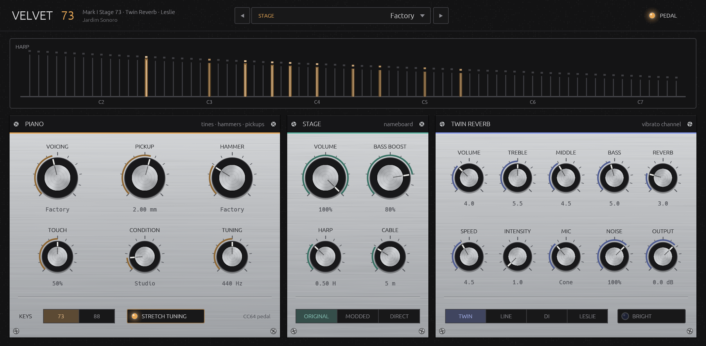
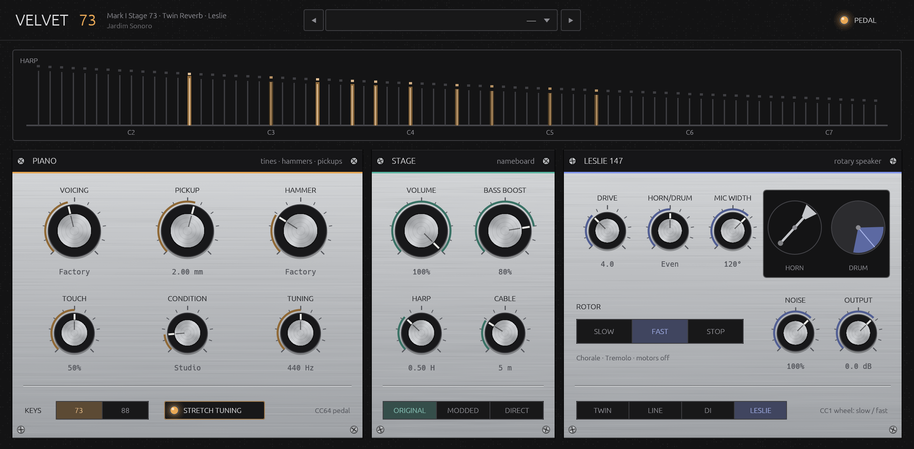

# Velvet73

*A Rhodes Mark I Stage 73 and the Fender Twin Reverb it was plugged into (or the Leslie, on the nights it was), modelled from the tine up.*

<a class="bmc" href="https://buymeacoffee.com/jardimsonoro" rel="noopener">
    
</a>

AU · VST3 · CLAP · standalone. macOS (Apple Silicon), Windows and Linux (x86_64).



## What is it, exactly?

An electric piano that is not a recording of one. There are no samples in here. There are 73 tone generators (88 if you ask), and each of them is simulated the way the service manual describes it: a neoprene-tipped hammer hits a steel tine, the tine and its twisted tone bar ring together as a "tuning fork of unequal legs", and the tip of the tine swings in front of a cone-shaped pickup whose magnetic field is anything but linear. Play softly and you get a sine wave with manners. Play hard and the tip sweeps across the field and you get the bark. Nobody designed the bark. It is a side effect of a pickup, and it became a genre.

The pickups are wired in series and parallel into one inductive harp, which meets the Stage's nameboard: a Volume pot and a control called Bass Boost that, on inspection, cuts bass. Then a cable, and the Vibrato channel of a silverface Twin Reverb: two 7025 stages, the tone stack, a spring tank, an optical tremolo with the temperament of a neon lamp, a 12AT7 phase inverter, four 6L6GCs with negative feedback and a power supply that sags when you lean on it, a 2×12 cabinet and a microphone somebody left in front of it.

Or, on the other nights, a Leslie 147: a horn and a drum spinning in a wooden box, two microphones, and a mod wheel to change your mind with.

Every number has a source: the Rhodes Service Manual, five Rhodes and Fender patents, a 1977 patent by Seth Lover with magnetometer curves of the pickup, and laser-vibrometer measurements of real tines (Gabrielli et al., 2020). What is measured and what is a design decision is written down in [docs/CIRCUIT.md](docs/CIRCUIT.md).

## Installing

| System | What to do |
|---|---|
| macOS | Unzip, run `./install.sh` (or copy `Velvet73.component` / `.vst3` / `.clap` into `~/Library/Audio/Plug-Ins/…`). If macOS objects to an unsigned stranger: `xattr -cr ~/Library/Audio/Plug-Ins/Components/Velvet73.component` |
| Windows | Copy `Velvet73.vst3` to `C:\Program Files\Common Files\VST3` and/or `Velvet73.clap` to `C:\Program Files\Common Files\CLAP` |
| Linux | Copy `Velvet73.vst3` to `~/.vst3` and/or `Velvet73.clap` to `~/.clap` |

In Ableton Live it appears under Plug-ins → Jardim Sonoro → Velvet73. There is also a standalone application, for people who keep their pianos away from computers.

## First contact (in five minutes)

1. Load it. You get **Factory**: a 1975 Stage fresh off the regulation bench, into a Twin on 4.
2. Play a chord softly. That is the bell.
3. Play the same chord as if you meant it. That is the bark. If it barks too early or too late for your keyboard, move **Touch**.
4. Hold the sustain pedal (CC 64) and play. Every free tine catches a little of each blow, the way the manual says it should.
5. Turn **Voicing** towards Bell and listen to the octave appear over the note. Turn it towards Deep and it becomes a sine with good posture.
6. Switch the Twin to **DI**. That is the piano with no amplifier, straight into the desk. Switch back.
7. Raise **Intensity**. The Twin's "Vibrato" is a tremolo. Fender called it vibrato, and the vibrato on their guitars a tremolo. It has never been fixed.
8. Switch the amp to **Leslie** and push the mod wheel up. The horn is at speed in about a second. The drum takes five. That disagreement is most of the charm.

## The panel, explained

**Piano** (amber): the regulation a technician would do with a screwdriver.

| Control | What it does |
|---|---|
| Voicing | Height of the tine tip against the pickup's axis. On the axis (Bell), the octave dominates. Slightly above (Factory), the richest tone. Well off (Deep), mostly the fundamental. |
| Pickup | Gap between tine and pickup, 0.5 to 3.2 mm, from F3 up. Closer is louder and barks sooner. Below F3 the pickups sit progressively closer, the way a technician evens out the level by ear, because a bass tine moves slowly. |
| Hammer | Hardness of the neoprene tips against the factory grading (30 to 90 durometer from bass to treble). |
| Touch | How much of your key velocity reaches the hammers. Lower keeps the bark for the loud notes. |
| Condition | Regulated, Studio, Gigged, Road worn. Tuning drift, uneven voicing, tired tines, worn dampers. The same piano every time you open it, just older. |
| Tuning | A4, 430 to 450 Hz. |
| Stretch tuning | The stretch chart from the service manual. Rhodes left the factory in equal temperament; tuners usually did not. |
| Keys | 73, or 88 with seven extra bass tines that have no tone bars (and sound like it). |

**Stage** (teal): the nameboard, in circuit with the harp.

| Control | What it does |
|---|---|
| Volume | The 10 kΩ pot. Loaded by the harp's inductance it is also a low-pass filter around 4 kHz. This is part of why a Stage sounds warm. |
| Bass Boost | A 50 kΩ rheostat across 47 nF. Fully up: flat. Turned down: less bass. The name is aspirational. |
| Harp | Inductance of the pickup harp, 0.33 to 0.85 H. Higher is darker. |
| Cable | Cable length, 1 to 15 m. Cables have capacitance. Capacitance has opinions. |
| Original / Modded / Direct | The factory nameboard, the technicians' favourite mod (50k, 250k, 10 nF, more top end), or the harp straight to the cable. |

**Twin Reverb** (blue): the Vibrato channel, which is where a Rhodes was plugged.

| Control | What it does |
|---|---|
| Volume, Treble, Middle, Bass | The amp's own knobs, 1 to 10. The tone stack is solved as a circuit, so the knobs interact as they do on the amp. |
| Reverb | The spring tank. Hit it hard and it splashes. |
| Speed, Intensity | The optical tremolo. At Intensity 1 it is off. |
| Mic | Microphone position, from the dust cap (brighter) to the cone edge (darker). |
| Noise | Hum and hiss as built (100%). Zero, if you must. |
| Output | Final level. |
| Twin / Line / DI / Leslie | Cabinet and mic, the amp's speaker tap without the cabinet, no amp at all, or the Leslie instead of the Twin. |
| Bright | The 120 pF bright cap. Most audible with the Volume low, as on the amp. |

**Leslie 147** (blue, when the amp is set to Leslie): the rotary speaker instead of the Twin, in stereo.

| Control | What it does |
|---|---|
| Drive | The combo preamp's level into the 147's 40 W amplifier. Past halfway it breaks up. |
| Horn/Drum | Balance between the rotating horn (treble) and the drum (bass). |
| Mic width | Angle between the two microphones: 0° is mono, 180° is one each side. |
| Rotor | Slow (chorale), Fast (tremolo), or Stop (motors off: the rotors coast to rest). The mod wheel (CC 1) also switches slow and fast, as organists do; touching Rotor takes control back. |
| Noise, Output | As on the Twin. |



The horn and the drum, seen from above, turn in the panel at the speed they are really turning. The pitch wobble is not an LFO: the horn's mouth really travels towards and away from each microphone, and so do its reflections off the cabinet walls, each with its own Doppler shift.

MIDI CC 120 (All Sound Off) silences everything at once. The **Pedal** lamp shows CC 64. The **harp** display shows each tine swinging; the glow is how far its tip moves.

## The presets

They live inside the plug-in (the selector at the top), not in your DAW's browser.

| Category | Presets |
|---|---|
| Stage | Factory, Bark, Bell, Deep Ballad |
| Twin | Vibrato Channel, Pushed Twin, Spring Wash |
| Leslie | Chorale, Gospel Grit |
| Studio | DI Console, Modded Stage, Twin Line Out |
| Worn | Road Worn, Stage 88 |

Changing preset resets the tines, so nothing from the last piano keeps ringing into the next one.

## Observations (recipes)

- **Seventies fusion:** Bark, Touch around 60%, play the left hand hard.
- **Ballad on a small stage:** Vibrato Channel, Speed 3, Intensity 5, sustain pedal down.
- **The record that was mixed through the desk:** DI Console, Bass Boost at 70%.
- **The piano in the rehearsal room nobody has serviced since 1983:** Road Worn, Noise 130%.
- **Glass:** Bell, Hammer above Factory, Bright on.
- **Sunday morning:** Chorale, sustain pedal down, mod wheel up for the last chorus.

## Questions occasionally asked

**Is it a sample library?** No. Every tine, hammer and pickup is computed while you play.

**Is there AI in it?** No. There is physics, a few circuits and some patience.

**Why is the output mono?** Because the Twin is mono. Switch to the Leslie and it is stereo: two microphones, one horn. The Suitcase's stereo autopan is next.

**It distorts too early.** Lower Touch, raise Pickup a little, or turn the Twin down. A real Stage into a Twin on 7 also distorts early.

**Is this affiliated with Rhodes, Fender or Leslie?** No. Rhodes, Fender and Leslie are trademarks of their owners and are named here only to say what was modelled.

## Roadmap

- Suitcase 73: Peterson and 100 W preamps, stereo vibrato, 4×12
- Mechanical noise (keys, dampers), double strikes, tines touching the pickup
- Lower CPU with pedalled chords (SIMD across tines)

Found something that sounds wrong? Open an issue with the preset, the register and how hard you played. Pull requests are welcome.

## Building from source

```
cargo test --release --lib
cargo truce install --au2 --user     # or --vst3 / --clap
```

Rust, [truce](https://crates.io/crates/truce) and egui. The engineering record is in [docs/CIRCUIT.md](docs/CIRCUIT.md), the research in [docs/RESEARCH.md](docs/RESEARCH.md) and the pickup analysis in [docs/PICKUP_ANALYSIS.md](docs/PICKUP_ANALYSIS.md).

## Licence

MIT, Jardim Sonoro. Not affiliated with, endorsed by or connected to Rhodes, Fender, Leslie, CBS, Hammond or their successors.
